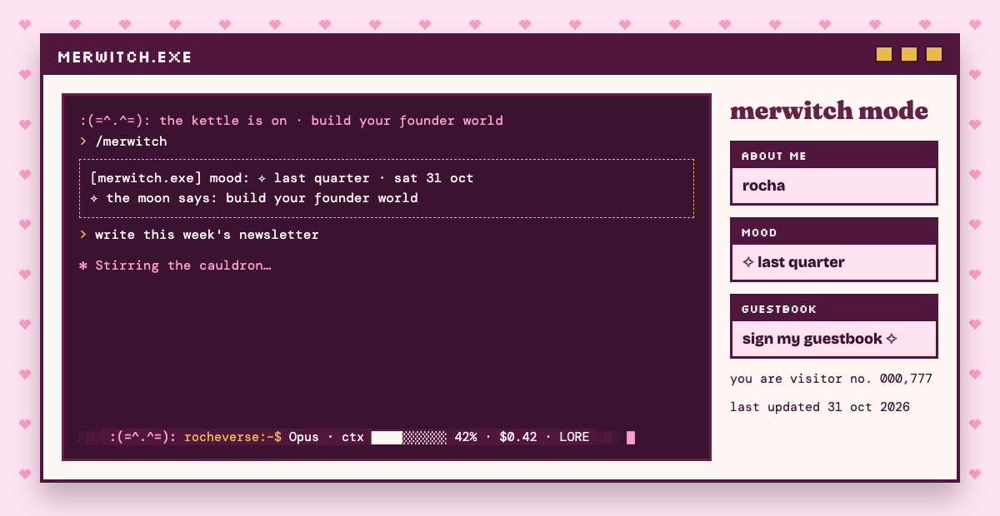
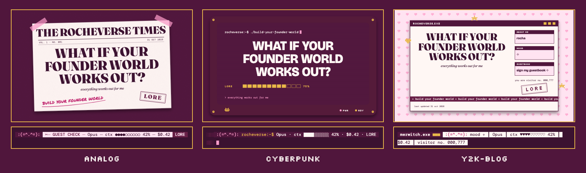

# merwitch-mode

*Rocha Coded. Free tools from the Rocheverse.*

**Your terminal, but it looks and sounds like a sacred tool, not a developer's.**

A plum line at the bottom of Claude Code, with a pixel leopard who keeps you company.
Witchy words while Claude thinks: reading the cards, stirring the cauldron, casting.
A soft chime when Claude is done, if you want one.
A daily omen when you type `/merwitch`.
Matching colours for your terminal, and a wallpaper to go with it.

<p align="center"></p>

<p align="center"></p>

<p align="center"><sub>One status line, three moods: analog, cyberpunk, y2k-blog. Your colours re-tone all three.</sub></p>

## Start here
You can do this. Each step tells you what to type and what you will see when it worked.
The **terminal** is the window where you type instructions to your computer. On a Mac, press Command and Space, type Terminal, and press Enter.

 This checks that Python, the language the tool is written in, is ready:
   ```sh
   python3 --version
   ```
   You will see `Python 3.10` or a higher number.

 This copies the tool onto your computer. To **clone** is to download a copy from GitHub, the site where the code lives:
   ```sh
   git clone https://github.com/RochaStone/merwitch-mode ~/.claude/skills/merwitch-mode
   ```
   You will see `Cloning into...` and then the line where you type comes back.

 This puts merwitch mode into Claude Code. It saves a backup of your Claude Code settings first. Pick your look at the end: `analog`, `cyberpunk` or `y2k-blog`:
   ```sh
   bash ~/.claude/skills/merwitch-mode/install.sh --motif cyberpunk
   ```
   You will see a few pink sparkles and `Done. Start a new Claude Code session to see it.`

 Close Claude Code and open it again:
   ```sh
   claude
   ```
   You will see a greeting at the top, the plum line at the bottom, and witchy words while Claude thinks.

 Draw today's omen. Type this to Claude:
   ```
   /merwitch
   ```
   You will see one line, with today's moon. It stays the same all day and changes tomorrow.

Want the chime? Run step 3 again with `--chime on` at the end. You will hear a soft two-note bell each time Claude finishes.

**If you use Claude Cowork** (the Claude desktop app): the status line, the thinking words and the chime belong to Claude Code.
In Cowork you can still get your omen, your terminal colours and your wallpaper. See [Claude Cowork](#claude-cowork).

<p align="center"></p>

## What you get
- **The status line.** The strip at the very bottom of Claude Code. Yours is plum, with the pixel leopard `:(=^.^=):`, the model, how full the conversation is, what the session has cost, and your stamp word. When the conversation is nearly full, the type turns gold.
- **Three looks.** `analog` is a guest check torn from the pad. `cyberpunk` is the girly terminal, with a prompt and a candy cursor. `y2k-blog` is a window called merwitch.exe, with a mood and a hit counter that counts your sessions.
- **The thinking words.** While Claude works you see "Reading the cards…", "Stirring the cauldron…", "Casting…" and nine more, instead of the usual ones.
- **The greeting.** Each new session opens with a line like "the candle is lit", and one of your lines.
- **The chime.** A soft bell when Claude finishes, and a quieter one when Claude needs you. It is off until you turn it on.
- **The omen.** `/merwitch` draws one line for the day: the moon phase, and a line from your style. It never makes up a slogan.
- **Your terminal colours.** Themes for iTerm2, Ghostty and Warp, made from your palette: `install.sh --themes`.
- **A wallpaper.** The same look for your desktop, in any of the three moods: `install.sh --wallpaper`.

<p align="center"></p>

## Install
| Where you use it | Install it | What you get |
|---|---|---|
| [Claude Code](#claude-code) (recommended) | clone into `~/.claude/skills`, run `install.sh` | everything |
| [Claude Cowork](#claude-cowork) | upload `merwitch-mode.zip` as a skill | the omen, your terminal colours, your wallpaper |

You need a Mac or Linux computer and Python 3.10 or newer. For the wallpaper picture you also need Google Chrome.

### Claude Code
```sh
git clone https://github.com/RochaStone/merwitch-mode ~/.claude/skills/merwitch-mode
bash ~/.claude/skills/merwitch-mode/install.sh
```
| Add this to the install line | What it does |
|---|---|
| `--motif analog`, `--motif cyberpunk`, `--motif y2k-blog` | picks your look |
| `--chime on`, `--chime off` | turns the chime on or off (it starts off) |
| `--glyph sparkle` | the leopard with sparkles `∴(=^･✧･^=)∴`, for terminals that show them |
| `--themes` | writes your iTerm2, Ghostty and Warp themes and puts them in place |
| `--wallpaper` | saves your wallpaper to `~/Pictures/merwitch.png` (add a size like `1920x1080` if you like) |
| `--uninstall` | takes it all back out and brings back your old status line |

Running the install twice changes nothing, and every change makes a backup of your settings first.
A **hook** is a small script Claude Code runs on its own at a moment you choose. merwitch mode uses three: when a session starts (the greeting), when Claude finishes (the chime) and when Claude needs you (the softer bell).
To update later: `git -C ~/.claude/skills/merwitch-mode pull`, then run the install line again.

### Claude Cowork
1. Download `merwitch-mode.zip` from the [latest release](https://github.com/RochaStone/merwitch-mode/releases/latest). A **zip** is one file that holds a whole folder.
2. In the Claude desktop app: Customize > Skills, then + > Create skill > Upload a skill, and pick the zip.
3. In Settings > Capabilities, turn on code execution and file creation.
4. Start a task with a folder, and say: "Draw my merwitch omen", "Make my terminal theme" or "Make me a merwitch wallpaper."

<p align="center"></p>

## Pairs with pocket-familiar
[pocket-familiar](https://github.com/RochaStone/pocket-familiar) is Lucky, the pink leopard who eats what you ship.
merwitch mode's pixel leopard is her cousin. Install both and they pair: Lucky moves into the merwitch status line, with her live mood, in place of the plain leopard.
Install pocket-familiar first, then merwitch mode, so the plum line is the one Claude Code shows. Both keep each other's hooks.

## Your words
The thinking words, the greetings and the omen openers live in one small file, `~/.claude/merwitch-mode/words.json`.
Open it, change any word, save it, and run the install line again. Your file is never overwritten, even when you update.
Your omens come from the `lines` in your style.json, so the omen speaks in your words.

## If it goes wrong (everyone's first time) 
This happens to everyone the first time. Here are the three most common moments and the fix for each.
- **The terminal says `command not found` for `python3` or `git`.** Your Mac may offer to install its developer tools. Click Install, wait for it to finish, and run the step again.
- **The bottom line shows odd boxes instead of blocks or hearts.** Your terminal font is missing those shapes. Switch your terminal font to one with more shapes, like Menlo or JetBrains Mono, and the blocks and hearts appear.
- **Nothing changed after installing.** Claude Code reads its settings when it starts. Close it fully and open it again. If you still see your old line, run the install again and read the last line it prints.

<p align="center"></p>

## Make it yours
Your look lives in one file, `style.json`: your colours, your stamp word, your world's name and your own lines for the omen.
It ships with two examples: `examples/style.rocha-coded.json` (my plum look) and a blank `style.example.json` for yours, explained in `STYLE.md`. Or ask Claude to make one with you from a few references.
Pick your motif, `analog`, `cyberpunk` or `y2k-blog`, to change the structure. Your palette re-tones all three, so every version is yours to curate.
Put it at `~/.rocha-coded/style.json` and every Rocha Coded tool uses it, so you make it once.

## What's inside
| File | What it does |
|---|---|
| `SKILL.md` | the steps Claude follows to set it up with you |
| `install.sh` | puts it in Claude Code, with a backup, and takes it out again |
| `statusline.py` | the status line in all three looks, from one function |
| `hooks.py` | the greeting, the chime and the softer bell |
| `omen.py` | the daily omen and the moon phase |
| `words.json` | your thinking words, greetings and omen openers |
| `themes/make-themes.py` | your iTerm2, Ghostty and Warp themes from your palette |
| `make-wallpaper.py`, `render.py` | your wallpaper in three looks, and the picture maker |
| `sounds/` | the chime and the bell, made from sine waves by `scripts/make-chime.py` |
| `scripts/merge_settings.py` | the careful settings editor: backup, no half-written files, keeps your other hooks |
| `scripts/make-readme-images.py` | makes every picture in this README from the tool itself, listed in `docs/IMAGES.md` |
| `tests/` | the tests, and `tests/TESTING.md` with exactly what was run |

Everything is plain Python from the standard library. No packages to install.

For the curious, try the status line by hand:
```sh
echo '{"model":{"display_name":"Opus"},"context_window":{"used_percentage":42}}' | MERWITCH_MOTIF=y2k-blog bash statusline.sh
```

## Credits
The status line, the themes and the wallpaper grew from **pink-terminal**, its sibling kit in *Claude Code for Founders* by the same author (MIT).

## Licence
MIT. See [LICENSE](LICENSE). Copyright (c) 2026 Rochelle Livingstone / Thriving Era Studio.

 [Sign my guestbook](https://github.com/RochaStone/merwitch-mode/issues)

## Made by Rocha

Rocha \
Brand Alchemist & AI Architect \
Author of *Brand Alchemy in the Thriving Era* \
Creator of [Conscious Founder OS](https://founders.thrivingera.com) \
Founder, [Thriving Era Studio](https://thrivingera.com)

I take female founders AI native in 7 days, and I build what they need next. \
Start with the audit: [thrivingera.com/audit](https://thrivingera.com/audit). \
Or book an exploratory call: [calendly.com/rochelle-thrivingera/exploratory-call](https://calendly.com/rochelle-thrivingera/exploratory-call). It is where we decide if we work together.

[Instagram @rocheverse](https://instagram.com/rocheverse) · [Substack](https://rochastone.substack.com) · [LinkedIn](https://www.linkedin.com/in/rochellelivingstonecosmic) · [More free tools](https://thrivingera.com/free) · [All tools on GitHub](https://github.com/RochaStone)
